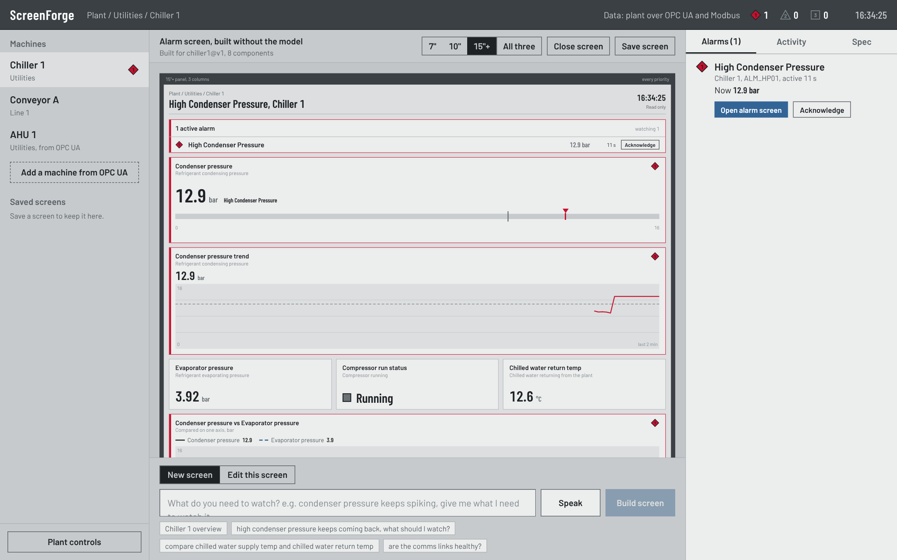
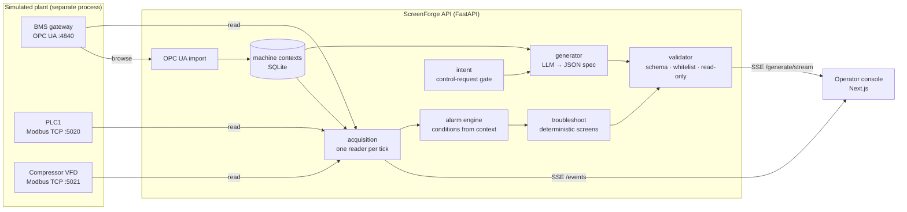
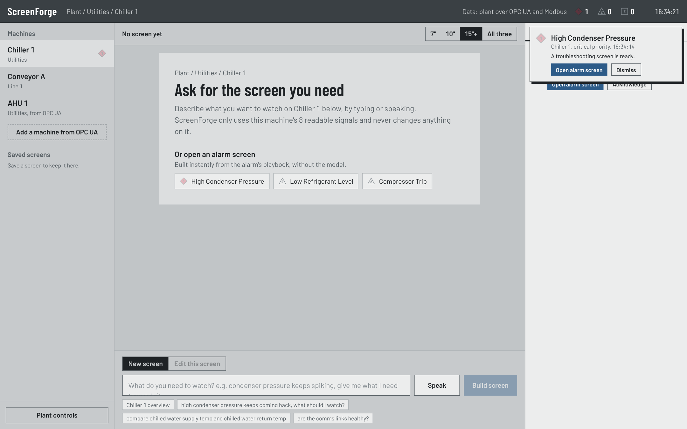
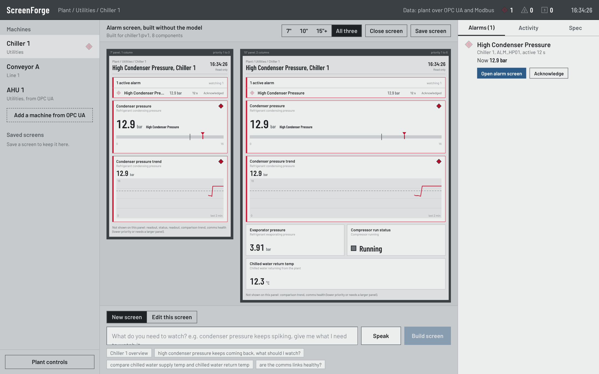
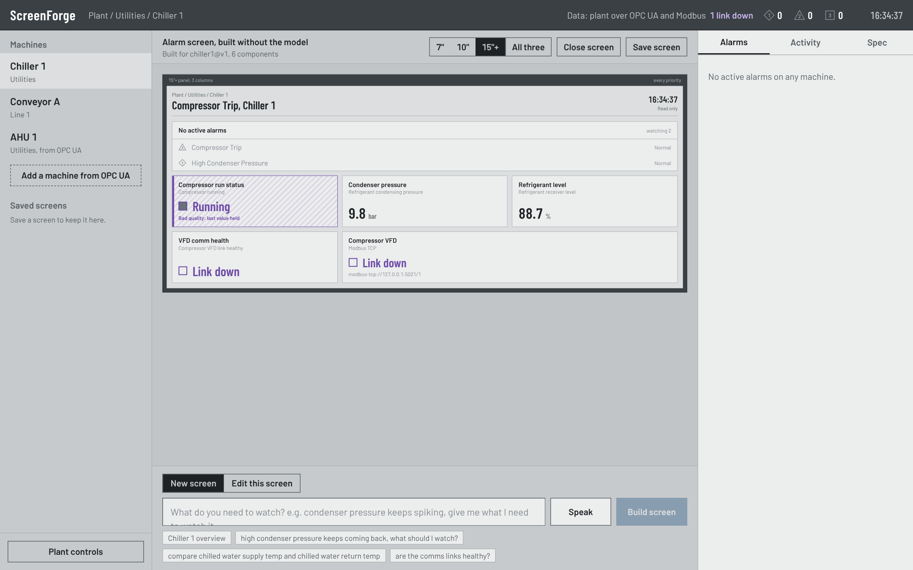
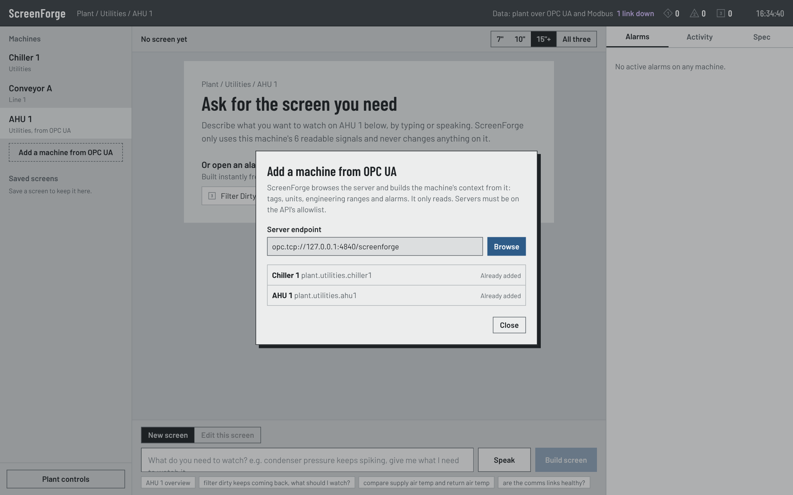

# ScreenForge

Operator screens on request, for industrial machines. An operator types or says
what they need to watch ("condenser pressure keeps spiking, give me what I need
to watch it") and gets a live, validated, read-only HMI screen for that machine,
laid out for a 7", 10" or 15"+ panel. When an alarm raises, a troubleshooting
screen for it is ready in under a millisecond, with no model involved.



> v1 was co-built with Kostubh Kumar at the Schneider Electric SMART HMI
> Innovation Marathon (SRM Chennai, Sep 2026), where it reached the final round.
> This repository is the v2 rebuild by Mokshad Kanaujia.

## The idea in one paragraph

The model never writes UI. It returns a small JSON screen spec: which component
types to show, bound to which tags, alarms or devices, with a priority and a
size hint. A three-layer validator checks that spec against the machine's real
tag list (schema, then a whitelist derived from the machine context, then a
read-only gate) and rejects it with a precise error rather than repairing it. A
deterministic layout engine turns priority and size into a screen for each panel
size. So the model cannot invent a sensor, cannot bind a command tag, cannot
pick colours or coordinates, and has no path to write to the plant.

## What v2 adds

| | |
|---|---|
| **Real protocols** | Live values over **OPC UA** (asyncua) and **Modbus TCP** (pymodbus) from a separate simulated plant. ScreenForge only ever issues read requests; the plant refuses and logs any write. |
| **One-click machine onboarding** | Point it at an OPC UA server: it browses the address space and builds the machine context itself, with engineering units, `EURange`, writable-node detection, alarms and their playbooks. No code change; the new machine is recognised in prompts straight away. |
| **Alarm-triggered screens** | On raise, a deterministic troubleshooting screen: the alarm, the signal as an indicator and a trend, the playbook signals, a same-unit comparison trend, and the health of the network link the value arrives over. Same alarm, same screen, every time. |
| **Data quality** | A value from a dropped link is held, hatched and labelled *bad quality*. An alarm on a bad-quality tag holds its state instead of tripping or clearing (ISA-18.2 practice): pulling the drive's cable does not read as a compressor trip. |
| **Conversational editing** | "Make the trend bigger, add evaporator pressure" edits the screen on display; the diff shows exactly what changed. |
| **Engineering ranges and alarm limits** | Contracts v2 carry ranges, alarm conditions and playbooks. Indicators are scaled to the real range with limit marks, never to recent history. |
| **Type-safe bindings** | The validator rejects a gauge on a boolean, a status light on a pressure, or a comparison trend that mixes bar and °C. |
| **ISA-101 operator console** | Grey is normal; colour means abnormal; alarm priority shown by shape as well as colour; real pipeline progress streamed from the API. |
| **Hardening** | Prompt-injection resistant prompt structure, identifier-only tag names, OPC UA endpoint allowlist, rate limiting, audit log, SQLite persistence, optional fully local model. See [docs/SECURITY.md](docs/SECURITY.md). |

## Architecture



## Run it

**Everything, with the live plant** (Docker):

```bash
cp api/.env.example api/.env     # add GROQ_API_KEY, or LOCAL_LLM_BASE_URL for an on-site model
docker compose up --build
# open http://localhost:3000
```

**Without Docker:**

```bash
# 1. the plant (optional; skip it to use the built-in simulator)
pip install -r plant_sim/requirements.txt
python -m plant_sim

# 2. the API
cd api && pip install -r requirements.txt
SCREENFORGE_TAG_SOURCE=live uvicorn main:app --port 8000    # or leave TAG_SOURCE unset for the simulator

# 3. the console
cd web && npm install && npm run dev
```

Alarm screens, the screen library, OPC UA import and everything live work
without an LLM key. Only screens from a typed or spoken request need one.

## Tests

```bash
cd api && python -m pytest -q          # 215 tests, 6 of them against the real plant over OPC UA and Modbus
cd web && npm test && npm run typecheck && npm run lint
python api/reliability_test.py         # real LLM: 32 requests + 5 edits, scored for relevance, not just validity
```

The reliability suite checks that each screen binds the signals the request was
about, not only that it passed validation. It includes typos, Hinglish, terse
requests, prompt-injection attempts and hallucination bait.

## Screens

| | |
|---|---|
|  |  |
| An alarm raises from a real fault; its screen is ready before the operator asks. | One spec, three panels: the 7" shows the alarm, the indicator and the trend. |
|  |  |
| The drive's link is pulled: its values go bad quality and the trip alarm does not fire falsely. | A machine ScreenForge had never seen, added by browsing the OPC UA server. |

## Layout of the repository

```
contracts/   JSON schemas for the screen spec and the machine context (v2), and fixtures
api/         FastAPI service: intent, generator, validator, alarms, acquisition, import, store
plant_sim/   the simulated plant: OPC UA server, two Modbus TCP devices, demo control port
web/         the operator console (Next.js, React, Tailwind)
docs/        security notes, demo script, screenshots
```

## Known limits

- The plant is simulated. The protocols are real; the physics is a drift model.
- OPC UA runs with security mode None in the demo. Production needs
  `Basic256Sha256` SignAndEncrypt with certificates (see SECURITY.md).
- No user accounts yet: acknowledgements and saved screens are not attributed to a person.
- Modbus has no security of its own; it belongs behind a conduit, never on a routed network.
